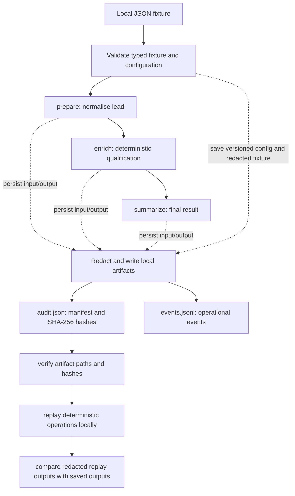

# Task 8 — Audit Records and Replay

A small, deterministic Python workflow that records each operation, saves its inputs and outputs, redacts synthetic secrets, verifies artifact integrity, and replays a saved run **without network, model, or external-service calls**.

This submission focuses on the auditability and replay behaviour required by Atomity's Task 8. The three workflow operations are deliberately synthetic; this is not a production workflow engine or a live CRM/AI integration.

**Challenge specification:** [Task 8 — Audit Records and Replay](https://github.com/atomityhq/engineering-challenge/blob/main/challenge/tasks/task-8.md).

## Contents

- [What it demonstrates](#what-it-demonstrates)
- [Requirements](#requirements)
- [Run it in a few steps](#run-it-in-a-few-steps)
- [Run the failed-operation example](#run-the-failed-operation-example)
- [Try an integrity-tampering demonstration](#try-an-integrity-tampering-demonstration)
- [Check malformed input](#check-malformed-input)
- [Inspect the saved run](#inspect-the-saved-run)
- [Architecture](#architecture)
- [Audit records and artifact integrity](#audit-records-and-artifact-integrity)
- [Typed contracts](#typed-contracts)
- [Tests](#tests)
- [Task 8 acceptance checklist](#task-8-acceptance-checklist)
- [Design decisions and trade-offs](#design-decisions-and-trade-offs)
- [Integration boundary](#integration-boundary)
- [Known limitations](#known-limitations)

## What it demonstrates

- Three deterministic operations: `prepare`, `enrich`, and `summarize`.
- A structured `audit.json` manifest with run and operation identifiers, statuses, artifact references, configuration information, and SHA-256 hashes.
- A separate `events.jsonl` stream for operational events; it is not used as a substitute for the structured audit manifest.
- Local input and output artifacts, with credential-like values redacted before persistence.
- Integrity verification that detects changed or missing referenced artifacts and rejects paths that escape the run directory.
- Offline replay that verifies artifacts first, re-runs the saved fixture using the saved configuration, and compares redacted outputs.
- Recorded operation failures, malformed-input rejection, synthetic-secret checks, and a test for unexpected exceptions containing a planted secret.

## Requirements

- Python **3.10 or newer**.
- Git, to clone the repository.
- No third-party runtime dependencies. The tests use Python's standard-library `unittest`; `pytest` is optional.
- No API keys, paid model access, database, network service, or credentials are required to run the workflow, tests, verification, or replay.

The commands below are run from the `src/task-8_drain-suiucide/` directory.

## Run it in a few steps

### 1. Clone the submission branch

Run these commands in PowerShell, Windows Terminal, or a shell with Git installed:

```powershell
git clone --branch submission/task-8-drain-suiucide --single-branch https://github.com/Drain-suiucide/engineering-challenge.git
cd engineering-challenge/src/task-8_drain-suiucide
python --version
```

Confirm that Python reports version 3.10 or newer. If the repository is already cloned, simply change directory to its `src/task-8_drain-suiucide/` folder and make sure you're on the submission branch.

### 2. Run the automated tests

```powershell
python -m unittest discover -s tests -v
```

Expected result: **27 tests pass** (`Ran 27 tests` followed by `OK`). The suite contains 11 workflow integration tests and 16 `OperationResult` contract tests.

### 3. Execute a successful workflow

```powershell
python -m workflow_audit run --fixture fixtures/successful-run.json --run-dir .runs/successful-run --run-id demo-success-001
```

Expected result: JSON output with `"status": "success"` and `"operations_recorded": 3`. The command creates `.runs/successful-run/` with the audit manifest, event log, redacted fixture copy, configuration, and operation artifacts.

### 4. Verify the saved artifacts

```powershell
python -m workflow_audit verify --run-dir .runs/successful-run
```

Expected result:

```json
{
  "status": "pass",
  "failures": []
}
```

Verification calculates hashes from the actual bytes on disk and compares them to the hashes recorded in `audit.json`.

### 5. Replay the saved run offline

```powershell
python -m workflow_audit replay --run-dir .runs/successful-run
```

Expected result: `"status": "match"`, `"operations_replayed": 3`, `"external_calls": 0`, and an empty `differences` list. Replay first verifies integrity, then reconstructs the result using the redacted saved fixture, saved configuration, and deterministic local operations. It does not call a network or model client.

> **Run directories are not overwritten.** To try the same command again, choose a new `--run-dir` (and preferably a new `--run-id`) or remove only the disposable demo directory you created.

## Run the failed-operation example

The second operation in this fixture is designed to fail. The failure should be recorded instead of being silently discarded.

```powershell
python -m workflow_audit run --fixture fixtures/failed-operation.json --run-dir .runs/failed-run --run-id demo-failed-001
```

The command reports `"status": "failed"` and returns exit code `2`. **That non-zero exit code is expected for this intentionally failing demonstration.** The saved run remains available for inspection.

Verify the failed run:

```powershell
python -m workflow_audit verify --run-dir .runs/failed-run
```

Expected result: `"status": "pass"` and no integrity failures. Now replay it:

```powershell
python -m workflow_audit replay --run-dir .runs/failed-run
```

Expected result: `"status": "match"`, `"operations_replayed": 2`, `"external_calls": 0`, and no differences. Here, `match` means replay reproduced the original failure; it does **not** mean that the original workflow succeeded.

## Try an integrity-tampering demonstration

This creates a separate disposable run and then changes one saved artifact by appending a single space. It does not modify the committed example files.

```powershell
python -m workflow_audit run --fixture fixtures/successful-run.json --run-dir .runs/tamper-demo --run-id tamper-demo-001
python -c "from pathlib import Path; p=Path('.runs/tamper-demo/artifacts/op-003-output.json'); p.write_bytes(p.read_bytes() + b' ')"
python -m workflow_audit verify --run-dir .runs/tamper-demo
```

Expected result after tampering: `"status": "fail"` with an `ARTIFACT_HASH_MISMATCH` entry for `artifacts/op-003-output.json`. Verification returns a non-zero exit code when integrity fails; that is expected for this demonstration. Replay is also blocked when integrity validation fails:

```powershell
python -m workflow_audit replay --run-dir .runs/tamper-demo
```

Expected result: `"status": "integrity_failed"` with the artifact mismatch reported. Use a different directory name for another attempt because runs are never overwritten.

## Check malformed input

The malformed fixture should be rejected before a run directory or a successful-looking audit record is created.

```powershell
python -m workflow_audit run --fixture fixtures/malformed-input.json --run-dir .runs/invalid-run --run-id demo-invalid-001
```

Expected result: a clear contract-validation error and exit code `2`. The `.runs/invalid-run` directory should not be created. The malformed-input test is also part of the automated suite.

## Inspect the saved run

A successful run has this layout:

```text
.runs/successful-run/
├── audit.json
├── config.json
├── events.jsonl
├── source_fixture.json
└── artifacts/
    ├── op-001-input.json
    ├── op-001-output.json
    ├── op-002-input.json
    ├── op-002-output.json
    ├── op-003-input.json
    └── op-003-output.json
```

Open `audit.json` to inspect the run ID, case ID, status, configuration version and hash, source-fixture reference and hash, operation IDs and statuses, artifact references and hashes, and safe failure details where applicable. Open each JSON file under `artifacts/` to inspect the persisted input or output. The source fixture saved inside a run is a redacted copy of the fixture used for replay; the original synthetic fixture stays under `fixtures/` to exercise the redaction tests.

For example, in PowerShell:

```powershell
Get-Content .runs/successful-run/audit.json
Get-Content .runs/successful-run/events.jsonl
Get-Content .runs/successful-run/artifacts/op-003-output.json
```

## Architecture



The diagram shows the logical flow. During execution, operation input/output artifacts and audit events are written as the operations run; the final manifest then references those artifacts. `events.jsonl` records operational events (for example, operation started/succeeded/failed and run completed), while `audit.json` is the structured manifest used to trace and verify the run.

## Audit records and artifact integrity

- **Traceability:** every run has a run ID, and each operation has an operation ID, name, status, and input reference. Successful operations also have output references; failed operations preserve a failure status, stable error code, and safe message.
- **Preservation:** the run stores a redacted source-fixture copy, versioned configuration, operation input/output artifacts, and a structured `audit.json` manifest.
- **Hashing:** SHA-256 hashes are computed from the actual bytes written to disk. `verify` checks hashes for the referenced configuration, source fixture, and operation inputs and outputs.
- **Replay:** integrity is checked before replay. The saved fixture and configuration are validated, the configured deterministic operation sequence is run locally, and redacted outputs are compared with persisted output artifacts.
- **Path safety:** artifact references must remain inside the run directory. Path-traversal references are rejected.
- **Failure behaviour:** an operation failure is recorded and stops later operations. Unexpected exceptions are converted to a stable error code and safe message; raw exception text and traceback are not persisted by the workflow.
- **Secret handling:** credential-like values and bearer-token strings are redacted before audit-boundary persistence. Event records contain metadata and safe failure details rather than raw operation payloads.

The hash manifest detects modifications relative to the stored hashes; see [Known limitations](#known-limitations) for the authenticity boundary.

## Typed contracts

The implementation uses validated dataclass-based contracts in `workflow_audit/contracts.py`:

- `WorkflowFixture` — validates the local workflow fixture.
- `WorkflowConfig` — validates the operation order and versioned configuration.
- `OperationResult` — enforces mutually consistent success/failure states and JSON-compatible output.
- `OperationRecord` — describes one persisted operation and its artifact references.
- `AuditEvent` — validates structured operational events.
- `AuditManifest` — validates the saved manifest and its operation records.
- `ReplayResult` — represents replay and integrity outcomes.

Malformed fixtures and invalid contracts produce defined failures rather than a misleading successful audit record. The `OperationResult` contract rejects unsupported values, circular structures, non-string object keys, non-finite numbers, unexpected fields, and invalid combinations of success/failure fields.

## Tests

Run the complete test suite locally:

```powershell
python -m unittest discover -s tests -v
```

If `pytest` is already installed, it can also be used:

```powershell
pytest -q
```

The runtime does not require installing `pytest`.

### Workflow integration tests (11)

The integration tests cover:

1. Successful three-operation execution and matching offline replay.
2. A deliberate operation failure recorded and reproduced by replay.
3. A planted synthetic secret in the fixture redacted from persisted artifacts.
4. A secret injected into an operation output redacted before persistence.
5. An unexpected exception containing a synthetic secret safely normalised and replayed.
6. A modified artifact detected, with replay blocked by integrity verification.
7. A malformed audit manifest rejected.
8. Extra operation records rejected during replay.
9. Malformed input rejected before the run directory is created.
10. Existing run directories not overwritten.
11. Artifact path traversal rejected.

The successful replay test also blocks common socket and HTTP entry points to test that replay does not attempt external network access.

### `OperationResult` contract tests (16)

The contract tests cover valid success/failure round trips and reject invalid output types, output on failure, explicit null failure/output fields, missing error codes/messages, unknown fields, unsupported values, non-string keys, non-finite numbers, circular data, and invalid direct dataclass construction.

The implementation in this task directory can be validated locally without third-party runtime dependencies or credentials. The commands above are the authoritative local checks for a reviewer.

## Task 8 acceptance checklist

| Task requirement | Implementation / evidence |
|---|---|
| Three deterministic fake operations | `prepare`, `enrich`, and `summarize` in `workflow_audit/workflow.py` |
| Run and operation traceability | `run_id`, `operation_id`, operation name, status, and artifact references in `audit.json` |
| Preserve fixture and configuration version | Redacted `source_fixture.json`, `config.json`, and version/hash references in the manifest |
| Save inputs, outputs, and content hashes | `artifacts/` JSON files and SHA-256 references in `audit.json` |
| Redact a planted fake secret | Synthetic marker in fixtures; redaction and leakage checks in tests; CI scans committed examples |
| Replay without external calls | `replay` command and integration test that blocks common network entry points |
| Record a failed operation | `fixtures/failed-operation.json` and `examples/failed-operation/` |
| Detect altered artifacts | Integrity verification, replay blocking, and tampering test/manual demonstration |
| Reject malformed input | `fixtures/malformed-input.json` and integration test |
| Separate audit records from operational events | `audit.json` manifest and separate `events.jsonl` event stream |
| Typed inputs and outputs | Validated contracts in `workflow_audit/contracts.py` |
| Setup, run, and test instructions | Commands in this README; no third-party runtime dependencies |
| Decision note, alternative, limits, integration boundary | Sections below |

## Design decisions and trade-offs

### Chosen approach: JSON manifest plus local artifacts

A structured JSON manifest plus ordinary local files keeps the execution inspectable, dependency-free, and easy to replay. The manifest references the artifact files instead of embedding all payloads into one large record. A separate JSON Lines file keeps operational events distinct from the audit manifest.

### Alternative considered: SQLite

SQLite would help with indexed queries across many runs, but indexed queries and schema migrations are unnecessary for three deterministic local operations. JSON files make this small challenge easier to inspect manually without adding a database dependency.

### Determinism and failure handling

Each operation is deterministic for its input and saved configuration. Replay uses the saved fixture and configuration, verifies artifacts before execution, and compares redacted outputs. A failed operation is retained with a stable code and safe message; later operations do not execute after that failure.

## Integration boundary

The implementation intentionally ends at a local, deterministic workflow. It does not invoke an LLM, browser, CRM, database, queue, or external API. The `OPERATIONS` mapping is the clear boundary for the three operation implementations; real integrations could be introduced behind small replaceable interfaces, while preserving the local fixture-driven replay path. Credentials, access controls, data retention, and production integration policies are outside this demonstration's scope.

## Known limitations

- **Heuristic redaction:** the pattern-based rules cover the planted synthetic marker and common credential-like strings, but cannot guarantee detection of every possible secret format. This is not a production secret-management policy.
- **Hash authenticity:** SHA-256 detects artifact changes relative to the hash values in `audit.json`. It does not authenticate who created the manifest. Someone able to modify both the manifest and its artifacts could recalculate the hashes; signatures or trusted append-only storage would be needed for stronger authenticity.
- **Local storage:** files do not provide production access control, retention, or tamper-resistant storage by themselves.
- **Synthetic workflow:** the three operations demonstrate audit and replay behaviour; they are not a production queue, scheduler, distributed workflow engine, or live business integration.

## Fixture reference

- `fixtures/successful-run.json` — all three operations succeed.
- `fixtures/failed-operation.json` — the second operation fails deterministically.
- `fixtures/malformed-input.json` — required lead data is missing or incorrectly typed.

The planted `FAKE_API_KEY` marker is synthetic test data, not a real credential.
